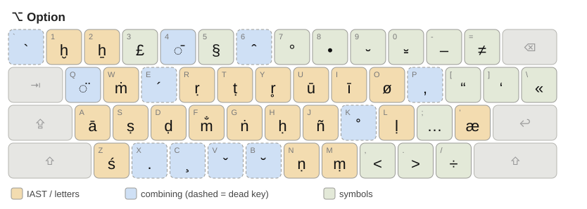
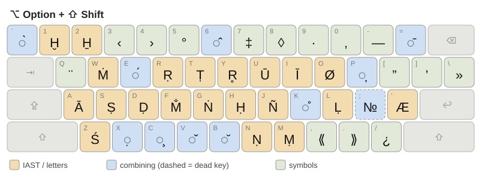

# ABC Extended – IAST

[English](README.md) · **中文**

[](LICENSE)


macOS 鍵盤布局，用 `⌥ Option` 組合鍵直接輸入 **IAST** 梵語轉寫
（[International Alphabet of Sanskrit Transliteration](https://en.wikipedia.org/wiki/International_Alphabet_of_Sanskrit_Transliteration)）、
長短音、格律符號與校勘符號。以 Apple 自帶的 **ABC Extended** 為基礎，不按 `⌥` 時一切與原來相同。

## 特點

- 所有 IAST 字母一鍵輸入：`⌥` 小寫、`⌥ ⇧` 大寫，包括 ṛ、r̥、ḷ、ṃ、ṁ、m̐、ḥ、ḫ、ẖ
- 任何字母都可**後置追加**長音符或兩點（`e` → `⌥4` = ē，`⌥R` → `⌥4` = ṝ，`a` → `⌥Q` = ä），
  重音可疊加（`⌥Y` → `⌥4` → `⌥⇧E` = r̥̄́）
- 格律符號 ⏑ – ⏓、校勘符號 ⟨ ⟩ ⟪ ⟫ ° § ◊ 各有專鍵
- 以標記為**英語**的 bundle 形式安裝，Word 會把輸入的文字當作英語（見 [Microsoft Word](#microsoft-word)）
- 沒有常駐程式、輸入法或管理員權限要求

## 預覽

| ⌥ Option | ⌥ Option + ⇧ Shift |
|---|---|
|  |  |

金色鍵輸入字母，藍色鍵追加組合符號（虛線框是死鍵，要先按再打字母），綠色鍵輸入符號。
兩張圖都由布局檔直接生成。

## 安裝

### 1. 下載

在本頁按 **Code → Download ZIP** 並解壓縮，或用 git：

```sh
git clone https://github.com/zyr-97/MacOS-ABC-Extended-IAST.git
```

### 2. 安裝

把整個 **`ABC-Extended-IAST-2.3.bundle`** 資料夾複製到 `~/Library/Keyboard Layouts/`。
在 Finder 按 `⇧⌘G` 貼上該路徑；若沒有 `Keyboard Layouts` 資料夾就新建一個。用終端機：

```sh
mkdir -p ~/Library/Keyboard\ Layouts
cp -R ./MacOS-ABC-Extended-IAST/ABC-Extended-IAST-2.3.bundle ~/Library/Keyboard\ Layouts/
```

請複製整個 bundle，不要只取出裡面的 `.keylayout`：英語語言標記在 bundle 裡。
然後**登出再登入**（或重新開機）。

### 3. 啟用

- **macOS 13 及以後：** 系統設定 → 鍵盤 → 文字輸入 → 輸入方式「編輯…」→ **＋**
- **macOS 12 及以前：** 系統偏好設定 → 鍵盤 → 輸入方式 → **＋**

在「英文」或「其他」分類中選 **ABC Extended - IAST 2.3**，再從選單列的輸入法選單切換過去。

**從舊版更新：** 每個版本都是獨立的輸入方式，2.3 可與 2.1 並存。先加入 2.3，確認無誤後再移除舊版。
如果裝過 2.2，請移除：它的 `⌥,` / `⌥.` 打不出 `<` / `>`。

## 按鍵對照

`⌥` = Option，`⇧` = Shift，同時按住。`→` 表示放開後再按下一組。
小寫字母（如 `e`）表示直接按該鍵。鍵位以美式 QWERTY 為準。
輸入 IAST 字母時請**關閉 Caps Lock**。

<!-- BEGIN GENERATED KEYMAP -->
### IAST 符號

按住 `⌥` 輸入小寫，`⌥ ⇧` 輸入大寫。

| 小寫 | 按鍵 | 大寫 | 按鍵 | Unicode |
|---|---|---|---|---|
| ā | `⌥A` | Ā | `⌥⇧A` | U+0101 / U+0100 |
| ī | `⌥I` | Ī | `⌥⇧I` | U+012B / U+012A |
| ū | `⌥U` | Ū | `⌥⇧U` | U+016B / U+016A |
| ṛ | `⌥R` | Ṛ | `⌥⇧R` | U+1E5B / U+1E5A |
| r̥ | `⌥Y` | R̥ | `⌥⇧Y` | U+0072 U+0325 / U+0052 U+0325 |
| ḷ | `⌥L` | Ḷ | `⌥⇧L` | U+1E37 / U+1E36 |
| ṃ | `⌥M` | Ṃ | `⌥⇧M` | U+1E43 / U+1E42 |
| ṁ | `⌥W` | Ṁ | `⌥⇧W` | U+1E41 / U+1E40 |
| m̐ | `⌥F` | M̐ | `⌥⇧F` | U+006D U+0310 / U+004D U+0310 |
| ḥ | `⌥H` | Ḥ | `⌥⇧H` | U+1E25 / U+1E24 |
| ḫ | `⌥1` | Ḫ | `⌥⇧1` | U+1E2B / U+1E2A |
| ẖ | `⌥2` | H̱ | `⌥⇧2` | U+1E96 / U+0048 U+0331 |
| ṭ | `⌥T` | Ṭ | `⌥⇧T` | U+1E6D / U+1E6C |
| ḍ | `⌥D` | Ḍ | `⌥⇧D` | U+1E0D / U+1E0C |
| ṇ | `⌥N` | Ṇ | `⌥⇧N` | U+1E47 / U+1E46 |
| ṅ | `⌥G` | Ṅ | `⌥⇧G` | U+1E45 / U+1E44 |
| ñ | `⌥J` | Ñ | `⌥⇧J` | U+00F1 / U+00D1 |
| ś | `⌥Z` | Ś | `⌥⇧Z` | U+015B / U+015A |
| ṣ | `⌥S` | Ṣ | `⌥⇧S` | U+1E63 / U+1E62 |

### 長短音

**長音**：ā ī ū 可直接輸入；其他字母先打字母，再按 `⌥4` 追加長音符。

| 輸出 | 按鍵 | 方式 |
|---|---|---|
| ā | `⌥A` | 直接 |
| ī | `⌥I` | 直接 |
| ū | `⌥U` | 直接 |
| ē | `e` → `⌥4` | 追加 |
| ō | `o` → `⌥4` | 追加 |
| ṝ | `⌥R` → `⌥4` | 追加 |
| ḹ | `⌥L` → `⌥4` | 追加 |
| r̥̄ | `⌥Y` → `⌥4` | 追加 |
| Ē | `⇧E` → `⌥4` | 追加 |
| ā | `a` → `⌥⇧=` | 舊入口 |

**短音**（breve）：

| 輸出 | 按鍵 | 方式 |
|---|---|---|
| ă | `⌥B` → `a` | 前置 |
| ĭ | `⌥B` → `i` | 前置 |
| ŭ | `⌥B` → `u` | 前置 |
| ĕ | `e` → `⌥⇧B` | 追加 |
| ŏ | `o` → `⌥⇧B` | 追加 |

**格律符號**：

| 符號 | 按鍵 | 說明 | Unicode |
|---|---|---|---|
| ⏑ | `⌥9` | laghu 短音節 | U+23D1 |
| – | `⌥-` | guru 長音節（en dash） | U+2013 |
| ⏓ | `⌥0` | anceps 可長可短 | U+23D3 |

### 校勘符號

| 符號 | 按鍵 | 說明 | Unicode |
|---|---|---|---|
| ⟨ | `⇧,` | 單角括號（左） | U+27E8 |
| ⟩ | `⇧.` | 單角括號（右） | U+27E9 |
| ⟪ | `⌥⇧,` | 雙角括號（左） | U+27EA |
| ⟫ | `⌥⇧.` | 雙角括號（右） | U+27EB |
| { | `⇧[` | 花括號（左） | U+007B |
| } | `⇧]` | 花括號（右） | U+007D |
| ° | `⌥7` | 省略符，如 °rakṣita、sva°（亦可 ⌥⇧5） | U+00B0 |
| § | `⌥5` | 節號 | U+00A7 |
| • | `⌥8` | 圓點 | U+2022 |
| ◊ | `⌥⇧8` | 菱形 | U+25CA |
| · | `⌥⇧9` | 中點 | U+00B7 |
| … | `⌥;` | 刪節號 | U+2026 |
| — | `⌥⇧-` | em dash | U+2014 |
| ‡ | `⌥⇧7` | 雙劍號 | U+2021 |
| ¨ | `⌥⇧Q` | 獨立兩點（不附著） | U+00A8 |

<details>
<summary>其他標點</summary>

| 符號 | 按鍵 | Unicode |
|---|---|---|
| &lt; | `⌥,` | U+003C |
| &gt; | `⌥.` | U+003E |
| “ | `⌥[` | U+201C |
| ” | `⌥⇧[` | U+201D |
| ‘ | `⌥]` | U+2018 |
| ’ | `⌥⇧]` | U+2019 |
| « | `⌥\` | U+00AB |
| » | `⌥⇧\` | U+00BB |
| ‹ | `⌥⇧3` | U+2039 |
| › | `⌥⇧4` | U+203A |
| ≠ | `⌥=` | U+2260 |
| ÷ | `⌥/` | U+00F7 |

</details>

### 組合鍵輸入

**前置**（死鍵）：先按組合鍵，再打字母。**追加**：先打字母，再按組合鍵，中間不按空格。

| 附加符號 | 前置 | 追加 | 例子 |
|---|---|---|---|
| 尖音符（acute） | `⌥E` | `⌥⇧E` | `⌥E` → `a` = á<br>`⌥A` → `⌥⇧E` = ā́ |
| 抑音符（grave） | `` ⌥` `` | `` ⌥⇧` `` | `` ⌥` `` → `a` = à<br>`⌥A` → `` ⌥⇧` `` = ā̀ |
| 揚抑符（circumflex） | `⌥6` | `⌥⇧6` | `⌥6` → `a` = â<br>`⌥A` → `⌥⇧6` = ā̂ |
| 長音符（macron） | — | `⌥4` 或 `⌥⇧=` | `e` → `⌥4` = ē<br>`⌥R` → `⌥4` = ṝ |
| 兩點（diaeresis） | — | `⌥Q` | `a` → `⌥Q` = ä<br>`u` → `⌥Q` = ü |
| 短音符（breve） | `⌥B` | `⌥⇧B` | `⌥B` → `a` = ă<br>`o` → `⌥⇧B` = ŏ |
| 抑揚符（caron） | `⌥V` | `⌥⇧V` | `⌥V` → `c` = č<br>`a` → `⌥⇧V` = ǎ |
| 下加符（cedilla） | `⌥C` | `⌥⇧C` | `⌥C` → `c` = ç |
| 上圓圈（ring above） | `⌥K` | `⌥⇧K` | `⌥K` → `a` = å |
| 下點（dot below） | `⌥X` | `⌥⇧X` | `⌥X` → `n` = ṇ<br>`e` → `⌥⇧X` = ẹ |
| 下逗號（comma below） | `⌥P` | `⌥⇧P` | `⌥P` → `s` = ș |

可以疊加： `⌥Y` → `⌥4` → `⌥⇧E` = r̥̄́；`⌥E` → `⌥A` = ā́；`⌥⇧A` → `⌥⇧E` = Ā́

**快速打出 ā́**：`⌥E` → `⌥A`。可以一直按住 Option，依次按 E、A，不必中途放開。
<!-- END GENERATED KEYMAP -->

全部實體鍵的四層輸出及精確碼位見 [`docs/輸出對照.txt`](docs/輸出對照.txt)，
一頁速查見 [`docs/符號速查.txt`](docs/符號速查.txt)，安裝與常見問題見 [`docs/安裝說明.txt`](docs/安裝說明.txt)。

## Microsoft Word

布局以 `.bundle` 而非單獨的 `.keylayout` 發佈，是因為 bundle 的 `Info.plist`
把輸入方式的語言聲明為英語（`TISIntendedLanguage = en`）。macOS 因此把這個輸入方式報告為英語，
Word 為新輸入的文字標記語言時可以據此判斷，切換輸入方式時就不會連帶改變校對語言和字體。

這個標記只是提示，不會鎖定格式，也不會設定字體或改動已有的文字：

- **校對語言：** 選取文字 → 工具 → 語言 → English → 確定。在同一對話框按「預設」可套用到新文件。
- **字體：** 格式 → 字體（`⌘D`）。若分開顯示西文與亞洲文字字體，請改西文字體。
- **方框或附加符號錯位**（m̐、r̥̄́、⏑、⏓、⟨ ⟩ 等）來自字體缺字，請改用支援這些字符的字體；
  語言設定解決不了缺字。

## 注意事項

- **Caps Lock 開啟**時，`⌥` + IAST 字母鍵會回到 ABC Extended 的原有輸出（例如 `⌥R` 變成 ®）。
  數字鍵、`Q` 和所有符號鍵不受影響。
- `⇧,` `⇧.` 輸出 ⟨ ⟩；`⌥,` `⌥.` 輸出 `<` `>`（2.3 起）。
- `Command`、`Control` 快捷鍵保持不變。
- `⌥A` 輸出預組字元 ā（U+0101），`a` → `⌥4` 輸出 a + U+0304。兩者在 Unicode 中等價，
  但部分搜尋工具會視為不同；布局不會替文件做正規化。
- 已帶長音的 ā 不要再按 `⌥4`，否則會疊上第二個長音符。
- 若某個 `⌥` 組合鍵叫出了其他程式（截圖、翻譯等），請在該程式中修改它的全域快捷鍵。

## 卸載

先切換到其他輸入方式，在鍵盤設定中移除 *ABC Extended - IAST 2.3*，刪除
`~/Library/Keyboard Layouts/ABC-Extended-IAST-2.3.bundle`，然後登出再登入。

## 從原始檔重建

一般安裝不需要這一步。需要 Python 3.8 以上，只用標準庫，不聯網：

```sh
python3 tools/build_and_verify.py     # 由 source/ 重建 bundle，寫出 verification.json
python3 tools/generate_reference.py   # 重新生成 docs/、assets/ 和 README 的按鍵表
```

建置只改動指定的鍵位，之後會把每個鍵、每種修飾鍵組合、每個死鍵狀態與原始布局及上一版（2.1）逐一比對，
並模擬約 400 組按鍵序列。文件和上面表格裡的每個例子，寫入前都經布局模擬輸入驗證。
這些檢查針對布局檔本身，不能代替在 Mac 上實際測試。

| 路徑 | 內容 |
|---|---|
| `ABC-Extended-IAST-2.3.bundle/` | 要安裝的布局 |
| `docs/` | 中文說明：安裝說明、輸出對照、符號速查 |
| `source/` | 基礎布局及 2.1 版，供建置與差異比對 |
| `tools/` | 建置、驗證及文件生成腳本 |
| `verification.json` | 上次建置的驗證結果 |

## 版本變更

- **2.3** — `⌥,` / `⌥.` 輸出 `<` / `>`（原為 ≤ / ≥）。
- **2.2** — 首次加入 `<` / `>`，但寫法 macOS 不接受，實際打不出來；請改用 2.3。
- **2.1** — `⌥1` / `⌥2` 輸出 ḫ / ẖ；`⌥4` 追加長音符，`⌥Q` 追加兩點；`⌥⇧Q` 為獨立的 ¨。
- **2.0** — m̐、ḫ、格律符號 ⏑ ⏓、省略符 °。
- **1.4** — 單／雙角括號、菱形、長元音加重音。

## 授權

[MIT](LICENSE)。布局衍生自 Apple 的 ABC Extended。本項目與 Apple 無關，授權只涵蓋本項目的修改、
文件與工具，詳見 [LICENSE](LICENSE)。
